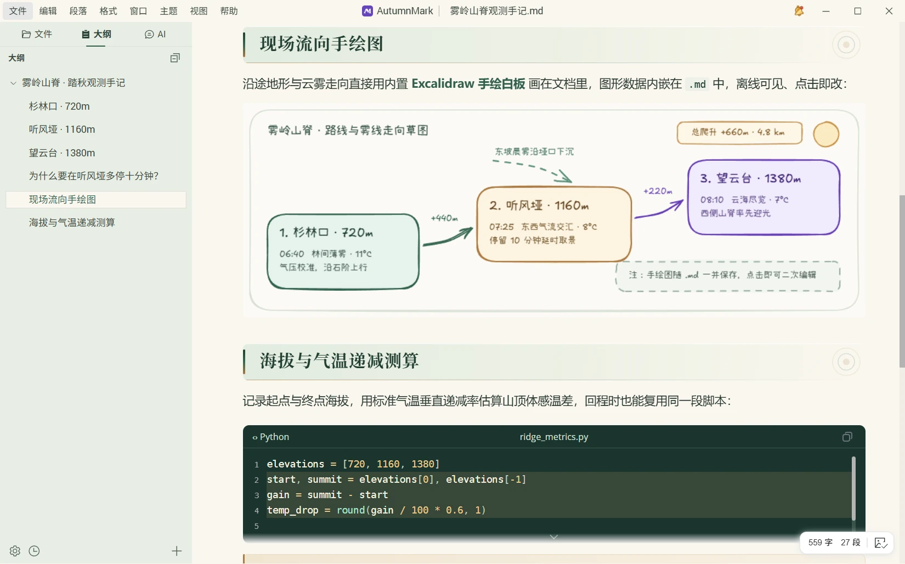

<p align="center"></p>

<h1 align="center">AutumnMark · 秋笺</h1>

<p align="center"><strong>单文件图文与手绘笔记，换个 Markdown 编辑器依然可读。</strong></p>

秋笺是一款开源桌面 Markdown 编辑器。粘贴截图或绘制 Excalidraw 手绘图，内容默认直接存进同一份 `.md` 文件，无需搭建图床；写教程或技术笔记时，可以用多选项卡切换步骤、用折叠块收起补充说明、给代码块加上居中文件名、行高亮与可拖拽预览高度——并且全部基于**可渐进回退的标准 Markdown 语法**，发给使用其他编辑器的读者也不会乱码或丢内容。

[访问官网](https://autumn-one.github.io/autumnmark/) · [下载正式版](https://github.com/Autumn-one/autumnmark/releases/latest) · [查看发布记录](https://github.com/Autumn-one/autumnmark/releases)




[查看截图中的示例 Markdown](docs/examples/ridge-notes.md) · [在官网切换浅色、手绘与代码、源码和深色视图](https://autumn-one.github.io/autumnmark/#preview)

## 核心特色与渐进回退

秋笺的扩展能力均建立在标准 Markdown 的标题、HTML 注释、图片链接与代码围栏之上，不引入私有二进制格式。同一份 `.md` 在秋笺与其他编辑器中的表现如下：

| 特色功能                     | 在秋笺里的体验                                                                                                                                  | 在其他 Markdown 编辑器 / 平台里                                                                                                   |
| ---------------------------- | ----------------------------------------------------------------------------------------------------------------------------------------------- | --------------------------------------------------------------------------------------------------------------------------------- |
| **无需图床的内嵌图片**       | 默认将粘贴截图、本地图片和网页图片以标准 `data:` 链接写入 `.md`，离线即看、单文件即发；支持拖拽调宽（可吸附 `100%`）、批量内嵌与源码折叠芯片。  | 支持 `data:` 图片的编辑器可直接离线显示。若目标平台过滤内嵌图片，可在秋笺中右键「转换为本地图片」或拖出原图，与文档一同发布。     |
| **可回退的扩展语法**         | 所有交互增强都以注释或扩展元信息附着在标准语法上，所见即所得，同时完整保留纯文本可读性。                                                        | 即使完全不认识秋笺扩展，也能按原顺序读到全部标题、段落、图片与源码，无语法污染、无厂商锁定。                                      |
| **多选项卡**                 | 输入 `/tabs` 即可创建选项卡组，点击标签切换不同平台步骤或节点记录，支持 `+` 新建、键盘切换与 `</>` 源码编辑。                                   | 每个标签对应普通标题（如 `#### \| 杉林口`），所有面板内容按源码顺序完整呈现，不丢信息。                                           |
| **折叠语法**                 | 输入 `/fold` 收起长日志、答案或背景说明，点击标题随时展开收起；导出 HTML 时转为原生可交互折叠块。                                               | `<!-- fold -->` 与 `<!-- /fold -->` 作为标准 HTML 注释自动隐藏，标题与正文完整显示。                                              |
| **代码块增强**               | 顶栏居中显示文件名、高亮关键行、限制长代码预览行数并支持拖拽底部边缘调高或一键展开；复制按钮始终复制完整源码。                                  | 仍是标准围栏代码块，所有编辑器都能正常语法高亮、阅读与复制完整代码。                                                              |
| **内嵌手绘图（Excalidraw）** | 输入 `/excalidraw` 直接在文档内绘制手绘流程图与架构草图，默认内嵌进 `.md`；点击画布随时弹出或移到标签页修改，支持拖拽调宽与 HTML/PDF 渲染导出。 | 以标准图片语法保存（也支持独立 `.excalidraw` 文件引用），源码模式折叠为简洁芯片；导出 HTML/PDF 时自动转为高清图片供任意平台阅读。 |

## 快速上手扩展语法

### 多选项卡

输入 `/tabs` 插入选项卡组，点击 `+` 添加标签；也可以直接编写标准 Markdown，组内以 `| ` 开头的标题即为标签名，其后的段落、列表、图片或代码块都归属该标签：

```markdown
<!-- tabs -->

#### | 杉林口 · 720m

**06:40 · 晨雾初散**　林间能见度约五十米，松针上的露珠尚未落下。

#### | 听风垭 · 1160m

**07:25 · 雾线交汇**　东坡的雾沿着垭口倾泻下沉，西侧山脊已经见光。

<!-- /tabs -->
```

### 无需图床的单文件内嵌图片

秋笺默认开启「嵌入 Markdown（Base64）」（可在「偏好设置 → 图片与导出」切换）。粘贴截图、拖入本地图片，或直接粘贴含图片链接的 Markdown 片段时，图片会自动写入 ``：

- **离线便携**：发给同事或跨设备同步只需这一个 `.md` 文件，不再受图床失效或外链防盗链困扰。
- **灵活互转**：支持右键「转换为本地图片」、文档/文件夹批量内嵌、拖拽左右边缘调整显示宽度，以及在源码模式下自动折叠为紧凑芯片。

### 内嵌手绘图（Excalidraw）

输入 `/excalidraw`（或通过菜单插入手绘图）即可唤出内置 Excalidraw 手绘白板：

- **默认单文件内嵌**：图形以 `` 保存在文档内；也可在偏好设置中切换为独立的 `.excalidraw` 文件引用。
- **实时编辑与调宽**：点击预览图即可在弹窗或独立标签页继续绘制并原地刷新；悬停拖拽左右边缘可调整宽度（自动以 `<!-- drawing-layout: width="100%" -->` 记住布局），导出 HTML / PDF 时自动渲染为高清图。

### 折叠语法

输入 `/fold`（或 `/折叠`），用两行独立 HTML 注释包住标题与正文。默认收起，如需默认展开可写 `<!-- fold open -->`：

```markdown
<!-- fold -->

### 为什么要在听风垭多停十分钟？

东西两侧坡面的气流在此交汇。每分钟拍一张照片，就能看出雾线抬升与回落的方向。

<!-- /fold -->
```

### 代码块增强

在代码围栏首行附加 `title="文件名"`、行高亮 `{2-4}` 与预览行数上限 `max-lines=5`；在编辑器里还可以直接拖拽代码块底部边缘调整预览高度，或点击底部箭头展开/收起：

````markdown
```python title="ridge_metrics.py" {2-4} max-lines=5
elevations = [720, 1160, 1380]
start, summit = elevations[0], elevations[-1]
gain = summit - start
temp_drop = round(gain / 100 * 0.6, 1)

print(f"累计爬升 +{gain} m，山顶约降温 {temp_drop} °C")
```
````

[完整扩展语法文档](https://github.com/Autumn-one/autumnmark/blob/develop/packages/website/content/docs/end-user/MARKDOWN_SYNTAX.md#content-tabs) · [图片与媒体内嵌指南](https://github.com/Autumn-one/autumnmark/blob/develop/packages/website/content/docs/end-user/IMAGES.md#embed-in-markdown-base64)

## 更多桌面端体验

- **内置精品主题与主题工坊**：默认搭载「松风明月」浅色与「暮紫日记」深色主题，内置多套配色、在线主题库与自定义 CSS 实时预览。
- **完整写作工具链**：支持 CommonMark 与 GFM、KaTeX 数学公式、Mermaid / PlantUML 图表、表格拖拽调宽与行列排序、专注/打字机/阅读模式、文档 AI 侧边栏，以及导出 HTML 与 PDF。

## 下载与本地开发

正式版提供 **Windows x64**（安装程序、便携 ZIP / 7z）、**macOS ARM64（Apple 芯片）** 与 **Linux x64** 安装包。[前往 Releases 下载](https://github.com/Autumn-one/autumnmark/releases/latest)

```bash
# 在仓库根目录安装依赖
pnpm install

# 启动桌面端开发模式
pnpm run dev

# 构建 Windows x64 安装包
pnpm run build:win:x64
```

详细开发规范与贡献方式请参阅 [贡献指南](.github/CONTRIBUTING.md)。

## 上游与许可

秋笺基于 MarkText 构建，感谢上游作者与社区贡献者。项目采用 MIT 许可证。[MarkText](https://github.com/marktext/marktext) · [上游贡献者](https://github.com/marktext/marktext/graphs/contributors) · [上游 README 译本](docs/i18n/) · [MIT 许可证](LICENSE)

<details>
<summary>MarkText 上游赞助信息</summary>

**Special Sponsor**

<table>
<tr>
<td width="182"><a href="https://serpapi.com/?utm_source=marktext"></a></td>
<td align="left"><a href="https://serpapi.com/?utm_source=marktext">Scrape Google and other search engines from our fast, easy, and complete API.</a></td>
</tr>
</table>

<!-- current-sponsors:start -->

**Current Public Sponsors (1)**

[](https://github.com/sponsors/marktext)

Only active, public GitHub sponsors are listed here. Thank you to our private sponsors as well.

<!-- current-sponsors:end -->

</details>
