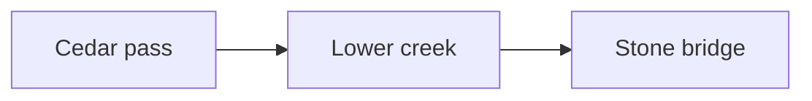

# Ridge notes

## Field journal

The mist lifted just before sunrise. Record **the trail condition**, *a personal observation*, and a filename such as `ridge.md`. Follow the [route details](#route-details) for the latest plan; ~~the old route~~ is closed.

The rain gauge collected 12 L of H~2~O per 10 m^2^. The latest trail report changed from [-dry-] to {+slippery+}. Look for the :compass: at the trailhead.

> Visit the same ridge again in five minutes.
>
> > A second observation tells you more about the weather than a single reading.

### Route details

| Stop | Elevation | Status |
| :--- | ---: | :---: |
| Cedar pass | 720 m | Open |
| Lower creek | 610 m | Slippery |
| Stone bridge | 645 m | Rest stop |

> [!TIP]
> Stay on the gravel at the creek. ==Wet stones are slippery.==

> [!NOTE]
> The distances in this journal start at Cedar pass.

> [!IMPORTANT]
> Leave the seasonal gate as you found it.

> [!WARNING]
> Cross the creek only while the stepping stones are visible.

> [!CAUTION]
> Keep clear of the bank below the stone bridge.

---

### Walking plan

1. Start from Cedar pass.
2. Cross Lower creek and follow the marked path.
   1. Check the depth at the first marker.
   2. Look for the sign on the opposite bank.
3. Turn back at the stone bridge.

- Carry enough water for the round trip.
- Pack a light rain layer.
  - Keep it near the top of the bag.

#### Before departure

- [x] Save the route.
- [x] Check the creek level.
- [ ] Record the return time.

##### Weather window

Visibility is best just after the fog lifts. The elevation readings are approximate.[^elevation]

###### Recording convention

Use metres for elevation and kilometres for distance. Hikes in this journal start at the same trailhead.

### Code and formulas

```js title="trail-time.js" {3,5}
// Measurements from the first stop.
const altitude = 720
const distance = 4.2

console.log(`Cedar pass: ${altitude} m`)
```

For an average speed of $v = 3$ km/h and a route length of $d = 4.2$ km, estimate the walking time with:

$$
t = \frac{d}{v} = \frac{4.2}{3} = 1.4\ \mathrm{h}
$$

Maps and reference material
---------------------------

![Sketch of the route between the three stops][ridge-map]



### Trail conditions

<!-- tabs -->

#### | Clear weather

Follow the blue markers along the ridge.

#### | Low visibility

Stay below the tree line and turn back at the creek.

<!-- /tabs -->

### Saving the journal

<p>Press <kbd>Ctrl</kbd> + <kbd>S</kbd> to save. The <abbr title="Global Positioning System">GPS</abbr> log belongs in the same folder.</p>

Review the [route details][route] before setting out. Additional Markdown examples are available at <https://commonmark.org/>.

[route]: #route-details "Route table"
[ridge-map]: ./ridge-map.png "Cedar pass to Stone bridge"
[^elevation]: Elevations come from the trail markers and are rounded to the nearest metre.
